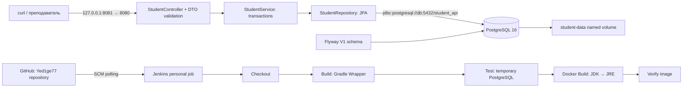

# Архитектура

Compose project: `yedige-batyrkhan-student-api`. Сервисы app/db используют отдельную сеть student-network. PostgreSQL не публикует порт на хосте; API публикуется только на loopback. Jenkins остаётся на 8080. Runtime приложения работает от UID/GID 10001. Flyway — единственный источник изменения схемы, `ddl-auto=validate` запрещает неявное изменение Hibernate.

Локальные integration tests используют отдельную БД student_api_test на 127.0.0.1:55432. Jenkins создаёт PostgreSQL-контейнер с уникальным именем по BUILD_NUMBER и отдельной сетью без опубликованных портов, затем удаляет только его. Тесты очищают свою таблицу students, поэтому тестовую БД нельзя подменять демонстрационной/рабочей.

Пределы: это учебный API без авторизации, пагинации и внешнего deployment. Секреты передаются через окружение; Docker environment доступен администраторам daemon. Named volume обеспечивает сохранение при restart/recreate, но не заменяет резервное копирование PostgreSQL.
